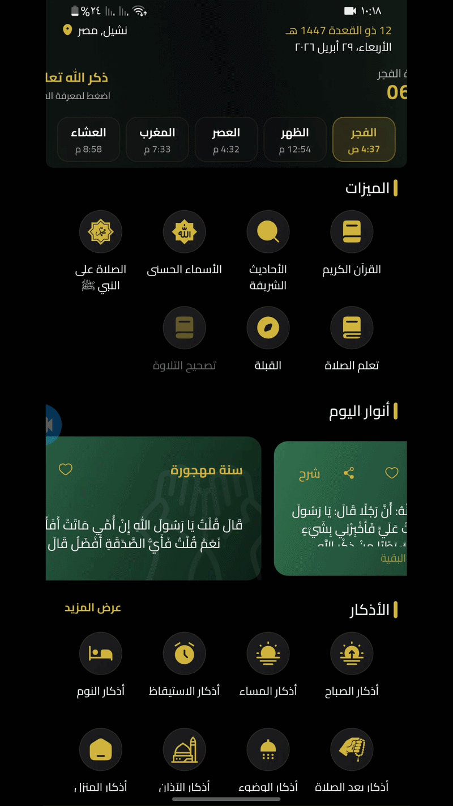
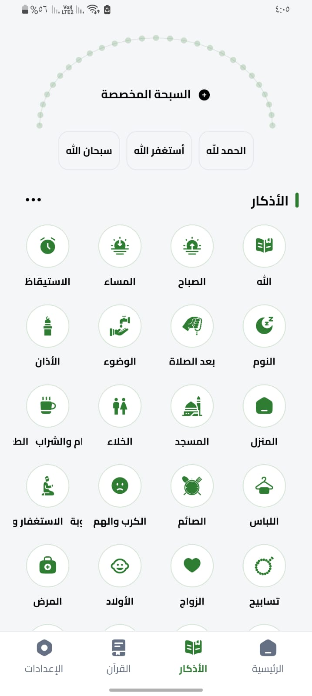
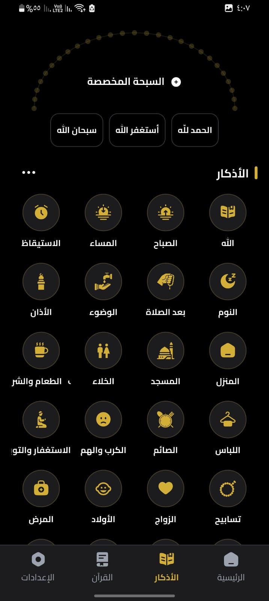

<div align="center">

<!-- Badges at Top -->
<p>
  <a href="https://github.com/Korya0/Sana/graphs/contributors">
    
  </a>
  <a href="https://github.com/Korya0/Sana/commits/master">
    
  </a>
  <a href="https://github.com/Korya0/Sana/network/members">
    
  </a>
  <a href="https://github.com/Korya0/Sana/stargazers">
    
  </a>
  <a href="https://github.com/Korya0/Sana/issues/">
    
  </a>
  <a href="https://github.com/Korya0/Sana/blob/master/LICENSE">
    
  </a>
</p>

<!-- Typing Logo (English Style) -->


<!-- Subtitle -->
<h3>A simple and clear modern Islamic companion.</h3>

<!-- Links Section -->
<p>   
<a href="https://sana0.vercel.app/">
  
</a>
<a href="https://play.google.com/store/apps/details?id=com.sana.muslim.app"> 
  
</a>
<a href="https://korya0.github.io/sana-landing/">
  
</a>
<a href="https://www.facebook.com/profile.php?id=61585568923187">
  
</a>
</p>

<br/>

<!-- Hero Animation -->


</div>

---


## 📸 Screenshots

<div align="center">
  <table>
    <tr>
      <td align="center"><b>الأذكار والتسبيح — فاتح</b><br></td>
      <td align="center"><b>الأذكار والتسبيح — داكن</b><br></td>
    </tr>
  </table>
  <p><a href="docs/features/azkar/README.md#screenshots">المعرض الكامل لصور الأذكار والتسبيح</a></p>
</div>

---

## 🧩 Feature Modules & Architecture

<details open>
<summary><b>📿 Azkar</b></summary>
<br>

> **Status:** Stable · **Docs:** [`docs/features/azkar/README.md`](docs/features/azkar/README.md) · **Spec:** [`docs/features/azkar/spec.md`](docs/features/azkar/spec.md) · **Screenshots:** [`docs/features/azkar/README.md#screenshots`](docs/features/azkar/README.md#screenshots)

**ببساطة:** أذكار جاهزة للتصفّح والقراءة والعدّ، مع سبحة مستقلة، وإنشاء أذكار وسبح خاصة بيك — كلها محفوظة على الجهاز من غير حساب.

**اللي تقدر تعمله**
- تصفّح أقسام الأذكار وتقرأها بعداد لكل ذكر، مع ضبط حجم الخط والاهتزاز والعد بأزرار الصوت (Android).
- تعمل أذكار وسبح مخصّصة، وتعدّل أو تحذف أو تستعيد الأصل، وتحتفظ بعدّادك أثناء التعديل.
- تعدّ بالسبحة في الهوم أو في شاشة السبحة، وتتحكم في النقص والتصفير من زر واضح.

**التفاصيل الكاملة** (التدفقات، القرارات، حالات الحدود، والمواصفات) في [`docs/features/azkar/`](docs/features/azkar/).
</details>

---

## 🛠️ Tech Stack

<hr style="height:1px;border:none;color:#333;background-color:#333;" />

- **Framework**: `Flutter` (Stable)
- **Language**: `Dart`
- **Native Bridges**: `Platform Channels`
- **Database**: `Hive` (High-speed local storage)
- **Cloud Interface**: `Firebase` (Analytics, Crashlytics, Remote Config)
- **State Management**: `Cubit (flutter_bloc)` with **Sealed Classes** (Dart 3 native)
- **Islamic Library**: Ruqyah, Prophetic Medicine, and Seerah datasets (Coming Soon) 🔜
- **Quran Hifz & Khatma**: Integrated memorization tracker, Khatma planner, and AI-powered recitation correction (Coming Soon) 🔜

---

## 🚀 Getting Started

<hr style="height:1px;border:none;color:#333;background-color:#333;" />

1. **Clone the repository**
   ```bash
   git clone https://github.com/Korya0/Sana.git
   ```
2. **Setup dependencies**
   ```bash
   flutter pub get
   ```
3. **Run for Mobile**
   ```bash
   flutter run
   ```

---

## 🤝 Contributing

<hr style="height:1px;border:none;color:#333;background-color:#333;" />

Contributions are what make the open source community such an amazing place to learn, inspire, and create. Any contributions you make are **greatly appreciated**.

1. Fork the Project
2. Create your Feature Branch (`git checkout -b feature/AmazingFeature`)
3. Commit your Changes (`git commit -m 'Add some AmazingFeature'`)
4. Push to the Branch (`git push origin feature/AmazingFeature`)
5. Open a Pull Request

---

## 📄 License

<hr style="height:1px;border:none;color:#333;background-color:#333;" />

Distributed under the **MIT License**. See `LICENSE` for more information.

---

## 💖 Acknowledgments

<hr style="height:1px;border:none;color:#333;background-color:#333;" />

- [quran_library](https://pub.dev/packages/quran_library) for the robust Quranic engine (complete with audio, tafsir, and search).
- [Adhan](https://pub.dev/packages/adhan) for precise astronomical calculations.
- [Dorar Encyclopedia](https://dorar.net/) for the comprehensive Hadith API.
- To all supporters of Islamic open-source software! 🌛

---

<div align="center">
Developed with passion for the Ummah 🌙
<br/>
<b>© 2026 Sana Team</b>
</div>
