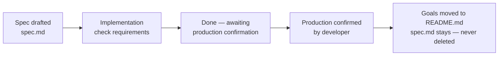
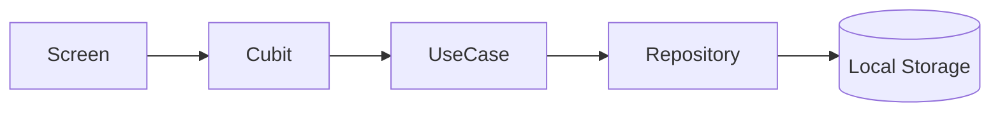

# Feature Documentation Rules

This file defines **how** we document app features inside `docs/features/`, from the first requirements draft to the final permanent docs.

Goal: let any developer (or AI assistant) understand a feature quickly without reading all the code, especially the **goals**, **decisions**, **flows**, and **non-obvious behavior**.

> The source of truth is always the code in `lib/`. Docs explain the code; they never replace it.

---

## 1. Core Principle: Document What Code Can't Tell You Quickly

**Write:**
- What the feature was meant to achieve, and what it intentionally does not do.
- Why a decision was made (and which alternatives were rejected).
- Flows that cross multiple layers or files.
- Edge cases and non-obvious behavior.
- Known limitations and temporary solutions.

**Don't write:**
- Lists of files or widgets that can be seen from the folder tree.
- Line-by-line explanations of what the code does.
- Any section with no real content (never pad a section just to fill the template).

---

## 2. Language Policy

- **All docs are written entirely in English**, including decisions, specs, and this rules file.
- Never translate code identifiers, class names, or file paths.
- Keep terminology consistent: one name per concept, matching the code.

---

## 3. Feature Lifecycle

Every feature goes through these stages. Each stage has one document.



| Stage | Document | Lifetime |
|---|---|---|
| Before and during development | `spec.md` (requirements + checklist) | **Permanent — never deleted** |
| After production | `README.md` (permanent docs) | **Permanent** |

> **spec.md is never deleted.** When a feature reaches production, set the spec status to `Done (awaiting production confirmation)`, then to `Production` once confirmed. The spec stays as a permanent record alongside `README.md`.

Small features (a simple screen, a minor tweak) can skip `spec.md` and go straight to a short `README.md`.

A feature that was already partly built can still get a spec (see Section 6.4).

---

## 4. The Rule

- Every feature has its own folder: `docs/features/<feature_name>/` (lowercase `snake_case`).
- **Start with a single `README.md`.** Split into more files only when it exceeds roughly 300 lines or a section becomes self-contained.
- Every change that affects a feature's **behavior**, **flow**, or **decisions** must update its docs **in the same PR/task**.
- Cosmetic-only changes (colors, spacing, variable renames) don't require doc updates.

---

## 5. Folder Structure

```
docs/features/<feature_name>/
├── spec.md          <- permanent: status changes from Draft → In progress → Done → Production
├── README.md        <- required, permanent
├── flows.md         <- optional: many or complex flows
└── decisions.md     <- optional: too many decisions for README
```

Don't add other files without a clear reason, and always link them from the feature's `README.md`.

---

## 6. Spec (`spec.md`): Requirements & Checklist

A spec is written **before** implementation so the AI (and you) build what you actually mean. It is a working document, not permanent documentation.

### 6.1 Template and layout

````markdown
# Spec: <Feature Name>

> **Status:** Draft | In progress | Done (awaiting production confirmation)
> **Created:** YYYY-MM-DD
> **Note:** (optional) e.g., "All requirements start unchecked and are compared against the code later."

## Goal
Pending: proposed wording, awaiting developer confirmation.
<One or two sentences: what problem does this feature solve for the user?>

---

## Part 1: <Area name>

### <Screen or topic>
- [ ] The user can do X.
- [ ] When Y happens, the user sees Z.

### <Another screen or topic>
- [ ] ...

---

## Part 2: <Area name>

### <Screen or topic>
- [ ] ...

---

## Part 3: Shared behavior (only if some behavior applies to several Parts)
- [ ] ...

---

## Part N: Quality assurance
- [ ] Verify that every feature file has complete unit and widget test coverage.
- [ ] Verify complete responsiveness across supported screen sizes, orientations, and text scaling for every feature screen and state, including dialogs and bottom sheets.
- [ ] Verify complete animation and motion behavior, including transitions and gesture-driven interactions, across every feature screen and state.
- [ ] Capture screenshots for every feature screen and state, including dialogs and bottom sheets, covering all possible cases, and store them under `screenshots/<feature_name>/` at the repository root.
- [ ] Organize and reference the feature screenshots in the root `README.md` and the feature `docs/features/<feature_name>/README.md`.
- [ ] Review all related docs and READMEs before closing the feature.

---

## Out of Scope
Decided by the developer; not part of this spec for now.
- <Item> (<short reason>).
- <Platform or technical limit that cannot be met>.

## Open Questions
- **<Short label>:** <the question, why it matters, and the current assumption if the AI made one>.
````

**Layout rules (every spec follows these):**
1. **One area:** skip the Parts and use a single `## Requirements` heading with `###` subsections.
2. **Several areas** (for example, two screens families or two sub-features): use `## Part N: <Area>` headings, separated by `---`.
3. **Inside a Part, group by screen or topic** with `###` headings, roughly 2-7 requirements each.
4. **Behavior shared by several Parts** (haptics, settings, permissions) goes in its own "Shared behavior" Part. Do not repeat it in each Part.
5. **One requirement per bullet, one line,** starting with the actor or the thing: "The user can...", "I can...", "Tapping X does Y", "The screen shows...". Use one voice consistently.
6. **Merge details that always go together** (an icon and its name is one bullet, not two). Split behaviors that can be verified separately.
7. **Name UI elements concretely** (`+` button, bottom sheet, app bar icon), so a requirement can be checked by looking at the app.
8. **Out of Scope lists decisions, not only ideas:** include features that were considered and rejected (with the developer's short reason in parentheses, so they are not proposed again) and technical or platform limits.
9. **Open Questions use a bold label,** then the question, why it matters, and the AI's current assumption if it made one. When a question is answered, remove it and move the answer into a requirement or into Out of Scope.
10. **Size:** roughly 8-15 requirements per Part. If a feature grows beyond about 4 Parts or 60 requirements, split it into separate specs (for example, one per sub-feature).
11. **Header Note:** when requirements come from old notes or another tool, or when completion is unknown, say so in the Note (for example, "All requirements start unchecked").
12. **Quality assurance (required):** every spec must include a final `## Part N: Quality assurance` (immediately before `## Out of Scope`) containing, at minimum, these requirements:
    - `[ ] Verify that every feature file has complete unit and widget test coverage.`
    - `[ ] A full integration test suite covers the complete feature flows.`
    - `[ ] Verify complete responsiveness across supported screen sizes, orientations, and text scaling for every feature screen and state, including dialogs and bottom sheets.`
    - `[ ] Verify complete animation and motion behavior, including transitions and gesture-driven interactions, across every feature screen and state.`
    - `[ ] Capture screenshots for every feature screen and state, including dialogs and bottom sheets, covering all possible cases, and store them under \`screenshots/<feature_name>/\` at the repository root.`
    - `[ ] Organize and reference the feature screenshots in the root \`README.md\` and the feature \`docs/features/<feature_name>/README.md\`.`
    - `[ ] Review all related docs and READMEs before closing the feature.`

### 6.2 What is a requirement (and what is not)

A requirement describes **what the user sees or does**. It never describes **how the code achieves it**.

Test: *"Can I verify this by using the app, without opening the code?"* If no, it is not a requirement.

| Not a requirement (implementation detail) | Write it as a requirement (user-visible behavior) |
|---|---|
| Uses in-memory caching and serialized writes | Changes I save are never lost, even if I save quickly several times |
| Preserves counters by clamping to new targets | If I edit a zikr while reading, my progress is kept |
| Guards against duplicate/stale handling | Tapping twice quickly does not cause a double action |
| Stored in a versioned JSON envelope | My custom categories are still there after updating the app |

Implementation details belong in the README under **Edge Cases & Limitations** (or **Data & Storage**), after the feature is built.

**Limitations are not requirements.** A known limit such as "progress is session-only" or "no cloud sync" goes under **Out of Scope**, never under Requirements.

### 6.3 Spec rules
1. **Requirements must be testable and user-visible** (see 6.2). Good: "Counter stops at the target and shows a toast". Bad: "The UI should feel easy" or "Uses a write queue".
2. **Keep it focused.** Aim for roughly 8-15 requirements per Part (see the size rule in 6.1). If you are listing code behavior line by line, you are writing the README, not a spec.
3. **Open Questions must be answered before implementation starts.** The AI must ask them; it must not pick answers on its own.
4. **Check off a requirement (`[x]`) only when it is implemented AND verified by actually using or testing the feature.** Code that exists but was never tried stays `[ ]`. The AI must never mark `[x]` based on reading code alone; only the developer confirms verification.
5. **Goal, Out of Scope, and Open Questions come from the developer.** The AI must not write them from code. Leave them as "Pending" and ask.
6. **Changing requirements mid-development:** edit the spec and keep the change visible (strike through or add a short note). Do not silently rewrite it.
7. **Out of Scope is mandatory** (even if it says "nothing"). It prevents scope creep from the AI.
8. **While a spec exists, the feature README status must be `In development`**, not `Stable`.

### 6.4 Starting a spec for a feature already in development

If a feature is partly built when the spec is created:
1. Derive the draft from the existing code, then **ask the developer** to confirm the Goal, Out of Scope, what is still missing, and the Open Questions. Never assume intent from code alone.
2. List what is **still missing** as `[ ]` requirements. This is the most valuable part of the spec.
3. Mark existing behavior `[x]` only if the developer confirms it works. Otherwise leave it `[ ]`.
4. Record choices already made during development as decisions now, while the reasons are still fresh. Ask the developer for the reason, or tag it [Inferred].
5. Set the feature README status to `In development`.
6. From this point on, follow the normal spec rules and the closing steps (Section 6.5).

### 6.5 Closing a spec (production confirmation)

When **all requirements are checked** and the **developer confirms the feature is in production**, the AI assistant must:

1. **Move the essentials into `README.md`:**
   - `Goal` and `Out of Scope` go into the README's **Purpose & Scope** section.
   - Real decisions made during implementation go into **Decisions** (see Section 8).
   - Any requirement that was dropped or deferred goes into **Tech Debt / Incomplete**.
2. **Update the spec status** from `Done (awaiting production confirmation)` → `Production (confirmed YYYY-MM-DD)`.
3. **Keep `spec.md` permanently.** It is a historical record and must never be deleted. Set `Status: Production (confirmed YYYY-MM-DD)` in the spec header and leave all checked requirements in place.
4. **Upload or update screenshots** for every screen or state that changed, stored under `screenshots/<feature_name>/` at the repository root (see Section 6.7).

> **spec.md is a permanent file.** The README is the living docs; the spec is the permanent requirements record. Both coexist forever.

### 6.6 Creating a spec from the developer's notes (Notion, docs, chat)

When the developer provides requirements in another place (Notion, a document, or a chat), the AI builds the spec like this:
1. **Convert every item into a requirement** in the layout of 6.1. Merge overly detailed items and keep each requirement user-visible (6.2).
2. **Statuses follow the developer's instruction.** If the developer says to treat everything as not done, leave all requirements `[ ]` and compare with the code afterwards. Never infer `[x]` from the code alone.
3. **Suggest extra requirements only when asked.** Present each suggestion as ready-to-paste requirement text with one line on its value. Accepted ones become requirements. Rejected ones go to Out of Scope with the developer's short reason. Undecided ones go to Open Questions.
4. **Feasibility questions are researched, not guessed.** When the developer asks whether something is possible (for example, a platform capability), search for current information and then:
   - write the achievable behavior as requirements,
   - write what cannot be done as Out of Scope,
   - write real risks and choices (for example, store-review risk) as Open Questions.
5. **List the AI's own assumptions** at the end of the reply and mark each in Open Questions as an assumption. The developer decides.
6. **After the spec is ready, compare it with the code** and report three groups: requirements that exist in code (candidates for `[x]`, pending the developer's verification), requirements missing from code, and behavior in code that is missing from the spec. Ask before adding or removing anything.

---

### 6.7 Screenshot rule — required after any screen change

Whenever a screen, bottom sheet, dialog, or visible state changes (layout, colors, sizing, new element, removed element), the AI assistant must:

1. **Ask the developer to capture a screenshot** of the affected screen/state.
2. **Store it under `screenshots/<feature_name>/<screen_or_state_name>.png`** at the repository root.
3. **Replace the old screenshot** if one already exists for that screen — never accumulate stale images alongside new ones.
4. **Reference it** in `docs/features/<feature_name>/README.md` under a `## Screenshots` section. If the section doesn't exist yet, add it.

> **This applies to every UI-touching task, cosmetic or behavioral.** A change that is too small to need a doc update still needs an updated screenshot if the screen looks different.

**Screenshot naming convention:**
```
screenshots/<feature_name>/<screen>_<state>_<light|dark>.png
```
Example: `screenshots/azkar/tasbeeh_home_card_empty_light.png`

**When to ask (trigger conditions):**
- Any widget resize, padding, or spacing change visible on screen.
- Any new or removed widget on a screen or bottom sheet.
- Any color, typography, or icon change.
- Any layout restructuring (column ↔ row, new card, new overlay, etc.).

---

## 7. Feature `README.md` Template

Copy the template and **delete any section that has no real content**.

````markdown
# <Feature Name>

> **Last reviewed:** YYYY-MM-DD
> **Status:** Stable | In development | Deprecated

## Purpose & Scope
- **Goal:** what the feature achieves for the user (carried over from the spec).
- **Out of scope:** what it intentionally does not do.

## Sources of Truth
The 3-6 most important files this doc is based on (used to detect stale docs).
Do not list every file; the AI can find the rest from these.
- `lib/features/<name>/presentation/cubit/<name>_cubit.dart`
- `lib/features/<name>/data/repositories/<name>_repository_impl.dart`

## Glossary
| Term | Meaning |
|---|---|
| ... | ... |

## Architecture & Flow
One Mermaid diagram of the layers or the main flow. Explain only what the diagram can't show.



## State & UI (only if non-obvious)
Only non-obvious state behavior (e.g., when a State is emitted, ordering rules).
Do not repeat what is already in Architecture & Flow.

## Data & Storage (if applicable)
Storage keys, formats, versioning, influential constants.

## Edge Cases & Limitations
Implementation-level safeguards and known limits:
- **Case:** what happens + why it is guarded + related file.

## Decisions
Strategic choices only (see Section 8).

## Tech Debt / Incomplete (optional)
What is temporary, deferred, or needs improvement, and why it was left.
````

---

## 8. Decisions

### 8.1 What counts as a decision
A decision is a **strategic choice with real alternatives**: architecture, storage approach, data model, a trade-off between two valid designs.

**Not a decision** (put these in *Edge Cases & Limitations* instead):
- Defensive guards (e.g., `isClosed` checks, double-tap protection, request cancellation).
- Implementation details with no realistic alternative.
- Bug-fix style safeguards.

Test: *"Would a reasonable developer have chosen differently?"* If no, it is not a decision.

### 8.2 Format (lightweight ADR)
Max 5-6 lines per decision.

```markdown
### D-001: <Decision title>
- **Decision:** What we chose.
- **Reason:** Why. Add [Inferred] if not confirmed by the developer.
- **Rejected alternatives:** What we dropped and why.
- **Date:** YYYY-MM-DD | unknown
- **Status:** Active | Unconfirmed | Superseded by D-00X
```

Example:

```markdown
### D-001: Store overrides in local storage, not a backend
- **Decision:** Store user overrides directly in `KeyValueStore`.
- **Reason:** The feature works offline and the data is small. [Inferred]
- **Rejected alternatives:** Firebase (extra complexity with no real benefit). [Inferred]
- **Date:** unknown
- **Status:** Unconfirmed
```

### 8.3 Changing decisions
When a decision changes: **don't delete the old one.** Mark it `Superseded by D-00X` and add a new decision.

---

## 9. Truthfulness Rules (read before writing anything)

Code shows **what** happens, but never **why** it was chosen or **when**. Guessing those is the most common documentation failure.

### 9.1 Facts vs. reasons
- **Behavior claims** (what the code does) come from reading the code.
- **Reasons ("why")** can almost never be proven from code alone. An AI assistant must **not present a guessed reason as fact**.
- Use exactly two tags, and only where needed:
  - **[Inferred]**: deduced from code but not confirmed by the developer.
  - **[Confirmed]**: explicitly confirmed by the developer (use sparingly, mainly in decisions).
- **Do not tag every line.** Untagged = verified from code. If everything is tagged, the tag means nothing.

### 9.2 Ask, don't invent
When a decision's reason is not known, the AI assistant must either:
1. **Ask the developer** for the reason, or
2. Write the reason with **[Inferred]** and set the decision's status to `Unconfirmed`.

It must never silently produce a confident-sounding reason.

### 9.3 Dates
- A decision's date is **when it was made**, not when it was documented.
- If the real date is unknown, write `Date: unknown`.
- Never copy today's date into every decision.
- `Last reviewed` in the README header is the only field that uses the documentation date.

---

## 10. Writing Guidelines

1. **Link to code:** mention the actual file path or class name (`lib/...`) when describing specific behavior.
2. **No duplication:** each fact lives in one section. If two sections say the same thing, keep the better one.
3. **Diagrams:** use **Mermaid only** (renders in GitHub and most markdown editors).
4. **Be concise:** prefer tables and bullet lists over long paragraphs. If a section is longer than one screen, trim it.
5. **Size guide:** a typical feature README is roughly 80-200 lines. Beyond 300, split per Section 5.
6. **Define terms early** and use the same name everywhere (docs and code).
7. **Don't paste code** except a short, essential snippet, because it will go stale.

---

## 11. Instructions for AI Assistants (Claude, etc.)

Put this block in `CLAUDE.md` (or the equivalent) at the project root so it applies automatically:

```markdown
## Documentation
- Follow `docs/FEATURE_DOCS_RULES.md` for all feature docs. Write everything in English, including decisions.
- Before modifying any feature: read `docs/features/<feature_name>/README.md` (and `spec.md` if it exists).
- After any change affecting behavior, flow, or decisions: update the docs in the same task and update "Last reviewed".
- After any UI change (layout, sizing, color, new/removed widget): ask the developer to capture an updated screenshot and store it under `screenshots/<feature_name>/` (see Section 6.7).

## New features (spec-first)
- For a non-trivial new feature: draft `docs/features/<name>/spec.md` first. Ask me every Open Question before implementing; do not choose answers yourself.
- Write specs using the layout in Section 6.1: Parts grouped by screen, one-line requirements, a Shared Part when needed, Out of Scope with short reasons, and Open Questions with bold labels.
- Requirements describe user-visible behavior only, never implementation details (caching, guards, write queues, clamping). Those go in the README under Edge Cases or Data & Storage.
- Limitations and known gaps go under Out of Scope, not Requirements.
- Never mark a requirement `[x]` based on reading code. Only after I confirm it was verified in the running app.
- Do not write Goal, Out of Scope, or Open Questions from code alone. Leave them "Pending" and ask me.
- When I give you requirements from Notion or elsewhere, convert them following Section 6.6. Suggest extra requirements only when I ask. Research feasibility questions before answering, and list your own assumptions at the end of the reply.
- If a feature is already partly built, create its spec from the existing code, list what is still missing as `[ ]`, and ask me to confirm the Goal and Out of Scope. Set the README status to `In development` while the spec exists.
- When all requirements are done and I confirm the feature is in production: move Goal and Out of Scope into README "Purpose & Scope", record real decisions, then update the spec status to `Production (confirmed YYYY-MM-DD)`. **Never delete `spec.md`.** It is a permanent record.

## Writing rules
- Never invent content for a section without real information; delete the section instead.
- Never present a guessed reason as fact. Ask me, or mark it [Inferred] with status Unconfirmed.
- Never use today's date as a decision date unless the decision was actually made today. Use "unknown" otherwise.
- Defensive guards and implementation details go in Edge Cases, not Decisions.
- Keep "Sources of Truth" to 3-6 key files. Untagged means verified from code.
- If docs conflict with code, the code is correct: fix the docs and tell me about the conflict.
```

---

## 12. Checklists

### Before finishing any task
- [ ] Did I change behavior, flow, or a decision? -> Docs updated.
- [ ] Is "Last reviewed" up to date?
- [ ] Are "Sources of Truth" 3-6 files, and do they still exist?
- [ ] Is every decision a real strategic choice (not a guard or implementation detail)?
- [ ] Is every unconfirmed reason tagged [Inferred] with status `Unconfirmed`?
- [ ] Are decision dates real or `unknown`?
- [ ] Is there duplicated content between sections?
- [ ] Did I remove empty sections?
- [ ] Is the feature listed in the index `docs/features/README.md`?
- [ ] Did I change any screen's appearance? -> Asked developer to capture and store a screenshot (Section 6.7).

### When writing or updating a spec
- [ ] The spec follows the layout in 6.1 (Parts, `###` groups, shared Part, `---` separators).
- [ ] Every requirement is one line, user-visible, and testable (no implementation details).
- [ ] Rejected ideas and platform limits are in Out of Scope with short reasons.
- [ ] Open Questions have bold labels and mark any AI assumptions.
- [ ] No limitations listed as requirements; they are under Out of Scope.
- [ ] `[x]` only on items verified in the running app.
- [ ] Goal, Out of Scope, and Open Questions were confirmed by the developer.
- [ ] README status is `In development` while the spec exists.
- [ ] The spec includes the required final `Quality assurance` part with the mandatory unit/widget coverage, full integration test, responsiveness, animation/motion, screenshots, and final docs-review requirements.

### When a feature reaches production
- [ ] All spec requirements are checked (or moved to Tech Debt).
- [ ] Goal and Out of Scope are in README "Purpose & Scope".
- [ ] Real decisions from implementation are recorded.
- [ ] Developer confirmed production.
- [ ] Spec status updated to `Production (confirmed YYYY-MM-DD)`. **`spec.md` is never deleted.**
- [ ] Screenshots up to date in `screenshots/<feature_name>/` and referenced in the feature README.

---

## 13. Feature Index

The index lives in a separate file: `docs/features/README.md` (a list of features with a one-line description and status). Don't put the index in this file, to keep rules and listings separate.

Example:

```markdown
# Features

| Feature | Description | Status |
|---|---|---|
| [azkar](azkar/README.md) | Azkar and tasbeeh | Stable |
| [new_feature](new_feature/spec.md) | Short description | In development |
```