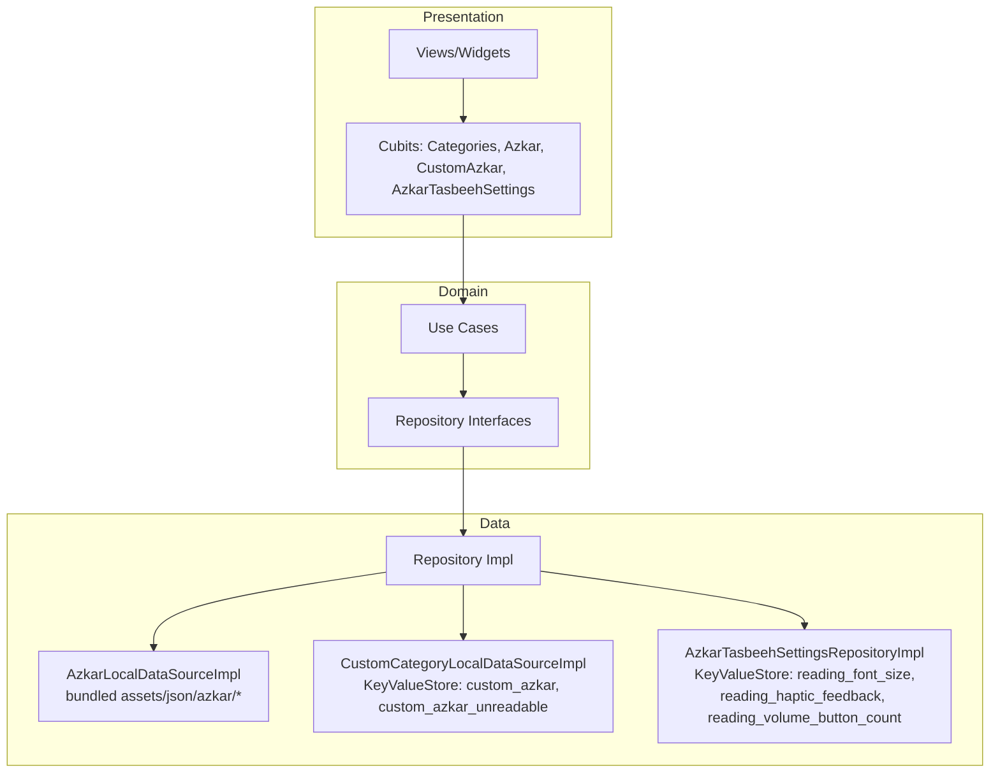
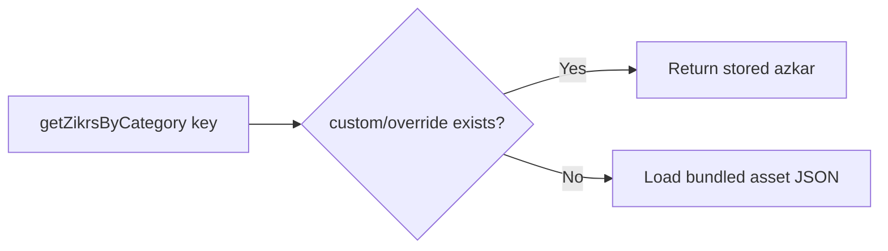

# Azkar

> **Last reviewed:** 2026-11-19  
> **Status:** In development

## Purpose & Scope
- **Goal:** Let users browse built-in azkar categories, read and count zikr in a reader, adjust reading font size, count with the hardware volume buttons on Android, and create/manage custom categories or overrides of built-in ones.
- **Out of scope:** No cloud sync or accounts. Reader zikr counters are in-memory per session; tasbeeh counts and targets are saved locally. Volume-button counting is Android-only for now; on other platforms the setting is visible but disabled, and iPhone support is deferred.

## Sources of Truth
- `lib/features/azkar/presentation/cubits/azkar/azkar_cubit.dart`
- `lib/features/azkar/presentation/cubits/categories/azkar_categories_cubit.dart`
- `lib/features/azkar/presentation/cubits/custom_azkar/custom_azkar_cubit.dart`
- `lib/features/azkar/presentation/cubits/tasbeeh/tasbeeh_cubit.dart`
- `lib/features/azkar/presentation/cubits/azkar_tasbeeh_settings/azkar_tasbeeh_settings_cubit.dart`
- `lib/features/azkar/data/data_sources/versioned_list_store.dart`

## Glossary
| Term | Meaning |
|---|---|
| Category (تصنيف/قسم) | An azkar collection. `AzkarCategoryEntity` (`key`, `title`, `cardTitle`, `isCustom`, `isModified`). |
| Zikr (ذكر) | A single item with target `count`. `ZikrEntity` (`id`, `text`, `count`, `description?`, `isUserAdded`). `canBeDeleted => isUserAdded`. |
| Custom category | User-created category stored with id prefixed `custom_` (`customCategoryIdPrefix`). |
| Override | Modified built-in category saved under the original built-in key (no `custom_` prefix) in custom storage; shown as `isModified`. |
| Restore | Delete the stored override/custom record so reading falls back to bundled original. |

## Architecture & Flow

`AzkarRepositoryImpl.getZikrsByCategory` resolves content by preferring a stored custom/override record for the key; otherwise it loads bundled asset JSON.

## State & UI (only if non-obvious)
- **Categories:** `AzkarCategoriesCubit` merges built-in + custom records, marks built-ins `isModified` when an override exists for the same key, and lists custom (`custom_`) first.
- **Reader:** `AzkarCubit` keeps per-zikr `counters` in memory and resolves `isCustom/isModified/resolvedTitle`. `incrementZikr` returns `CounterIncremented|Completed|Ignored`; `applyCategoryUpdate` clamps counters to new targets to preserve session progress; `restoreCategory` deletes the override and reloads the original.
- **Reader completion/exit** (`presentation/views/zikr_list_view.dart`): auto-close triggers only when the session becomes fully completed with the same azkar list instance (not when edits make it complete). Auto-scroll targets the first incomplete item. Exit asks confirmation if progress started and not all completed.
- **Reader copy:** Each zikr card has a copy button that copies the resolved category title, zikr text, and its description when present, with each section wrapped in `« … »`. The shared `copyText` helper (`lib/core/services/clipboard/clipboard_copy.dart`) performs the copy and shows an error toast only — a successful copy needs no message because the system already confirms it.
- **Custom management:** `CustomAzkarCubit` returns `Result<void>` from save/delete, reloads on success and normalizes built-in category names to app-owned originals when listing. One-shot success feedback lives in the caller, not in cubit state.
- **Reading settings:** `AzkarTasbeehSettingsCubit` applies font-size changes immediately; on save failure it emits `Error` carrying persisted settings so the UI can revert and toast. (`widgets/common/font_size_section.dart`)
- **Reset controls:** In the reader, each zikr card's existing reset icon uses the two-level gesture for its own zikr: a single tap decrements by one, a long press resets it to zero. On the tasbeeh screen the "تصفير العداد" button does the same for the selected item. No dialog and no extra app-bar icon. Both controls are disabled when the count is already zero. (D-025)
- **Home gauge:** the saved-tasbeeh card is display-only — no tap counting and no fingerprint cue. It shows beads, the count and the text at the same level as the empty-state prompt, with a centered "متابعة التسبيح" chip below the beads (label then left-pointing arrow) that opens the counter screen. (D-026, D-032)
- **Volume buttons (Android):** The setting is enabled by default (`AzkarTasbeehSettingsEntity.defaultVolumeButtonCountEnabled = true`), so counting works on the first open; if the user turns it off, the stored `false` is kept and respected. `VolumeCounterBinding` attaches only while the setting is on, the counter is ready, the route is current, and the app is resumed. It reads the shared `VolumeButtonsService`; the native `MainActivity.dispatchKeyEvent` consumes volume keys and sends one event per physical press (`repeatCount == 0`). The reader counts the first incomplete zikr; the tasbeeh screen counts the selected item. Volume down stops at zero. On non-Android platforms `VolumeButtonCountToggleTile` shows the switch off and disabled with an Android-only hint.
- **Tasbeeh:** `TasbeehCubit` keeps selection and independent counts for saved items. Custom text is whitespace-normalized, limited to 200 characters, and targets/free counts are capped at 9999; reaching a target starts the next cycle at one on the next tap.
  - **Home card:** when empty it shows a non-tappable bead-arc start gauge with no count slot; its prompt is a brand-colored text button "السبحة المخصصة" with an add icon that opens the custom-tasbeeh sheet, followed by three compact light-bordered preset chips centered (الحمد لله، أستغفر الله، سبحان الله); when saved it shows the most recently used item's count on the same gauge and its text on up to two lines (no marquee, no remaining-count line) with a centered "متابعة التسبيح" chip below the beads (label then left-pointing arrow); there is no tap-to-count, fingerprint cue or All button. The count and text sit at the same level as the empty-state prompt.
  - **Counter screen:** the selector opens the shared item sheet without reading settings and switches in place. The zikr and counter are centered as a group, with a filled primary reset button (icon above a single-line label) beside the selector; the app-bar options sheet keeps reading settings.
- **Tasbeeh option sheets:** The tasbeeh screen's app-bar sheet keeps its current reading-settings section; the item list is also reachable from the counter screen's selector. Both sheets' "إنشاء سبحة" action carries the shared add icon.
- **Home layout:** The screen has no app bar; it starts with the tasbeeh card, then the azkar section header and its categories grid. The section header's trailing more icon opens the options sheet with manage custom azkar first, then the shared reading settings rows (font size, haptics, volume buttons). No separate create action; the management screen carries it in the app bar when the list has items, while the empty state keeps a body button.
- **Input validation:** every text field requires at least 3 Arabic letters and rejects punctuation-only values; category names and tasbeeh texts reject duplicates; counts are capped at 9999 in the field validator, the cubit and the storage models. (`core/utils/app_validators.dart`)
- **Bottom sheet headers:** every sheet has a centered drag handle, then one header row: the title sits at the start beside a close (`X`) icon when the sheet opens over a screen, or a back icon when it opens from another sheet (font size), with a divider below it. Form sheets put their text Save action at the opposite end and have no Save/Cancel buttons at the bottom; Save stays disabled until the form fields are valid, and close/back runs the unsaved-changes guard. (`core/widgets/overlays/app_sheet_header.dart`)
- **Bottom sheet body:** fields and options are rows in a card inset from the sheet sides with a different background, separated by light dividers. No section titles or trailing arrow icons; restore/delete rows sit last in red. (`core/widgets/overlays/app_sheet_body.dart`)
- **Form fields:** `AppTextField` and `AppTextAreaField` share `FieldLabel`: required labels carry a red `*` mark (`AppStrings.requiredFieldMark`), optional labels append "(اختياري)". No text field grows with its content: `AppTextAreaField` renders its inner `TextField` with `expands: true` inside a fixed-height box (`minHeight ?? AppSize.h150`, no inner padding), so the zikr text, virtue and tasbeeh text fields keep their box height and scroll the full text inside it — the text area always fills the box down to the bottom border; `AppTextField` stays single-line. Character counters count user-perceived characters (`text.characters.length`), matching the enforced `LengthLimitingTextInputFormatter` limit, and every target-count field shares `AppConstants.targetCountMaxDigits = 4`.
- **Counters:** one widget, `CounterRing`, drives both the zikr and tasbeeh counters. A non-null target shows the remaining count (`target - current`) and completes on reaching it; a null target counts without a target until 9999 and does not report target completion.
- **Routes:** reader `/azkar/:categoryKey`, custom form `/custom-zikr-form`, manage list `/custom-azkar-list`, plus azkar tab in shell (`lib/core/router/app_routes.dart`, `lib/core/router/features/azkar_tasbeeh_router.dart`). Screens reload on return where needed to stay in sync with storage.
- **Progress and selection:** `AzkarLoaded.getProgressFor(id)` is the single per-zikr progress value (remaining/completed/can-reset) used by cards, Semantics and actions; `TasbeehLoaded` exposes `selectedItem/canResetSelected`. `HapticFeedbackToggleTile` (`widgets/common`) is the one haptics toggle shared by the option sheets and owns the save-failure listener.
- **Feedback (see D-008):** full-page loads show a skeleton that mirrors the loaded state pixel-for-pixel (`AzkarCategoriesSkeleton`, `ZikrListSkeleton`, `CustomAzkarListSkeleton`, `TasbeehPresetGridSkeleton`) — never a spinner or toast. Mutations keep the current UI and disable their control. Success toasts confirm only one-shot mutations whose result is not otherwise obvious (category save/delete/reset, session completion); copy and counter increments never show a success toast. Every failed user-initiated operation shows an error toast (copy via `copyText`, settings via `HapticFeedbackToggleTile`/`VolumeButtonCountToggleTile`/`AzkarTasbeehSettingsBottomSheet`, mutations via the caller); a failed full-page load shows `AppErrorView` with retry. Counter increments revert silently because the count change itself is visible.

## Data & Storage
- **Bundled source:** `assets/json/azkar/categories.json` and `assets/json/azkar/<key>.json` via `AzkarLocalDataSourceImpl`.
- **Custom/overrides store** (`AppStorageKeys.customAzkar`, `CustomCategoryLocalDataSourceImpl`): versioned JSON envelope `{ "version": 1, "items": [...] }`; reads accept legacy list or missing version; uses in-memory cache and a serialized write queue; skips corrupted items (with logging) and best-effort backs up unreadable raw payload to `custom_azkar_unreadable` (not overwritten if present). The envelope, cache, write queue and backup logic live once in `VersionedListStore<T>` (`data_sources/versioned_list_store.dart`); each data source supplies keys and JSON mapping.
- **Reading settings:** `AppStorageKeys.readingFontSize` (`double`, default 20, clamped 14–32), `reading_haptic_feedback` (`bool`, default true), and `reading_volume_button_count` (`bool`, default true on first open) in `azkar_tasbeeh_settings_repository_impl.dart` / `azkar_tasbeeh_settings_entity.dart`.
- **Tasbeeh items:** `AppStorageKeys.tasbeehItems` stores each item's text, count, optional target, and last-used time in the same `VersionedListStore` envelope (`TasbeehLocalDataSourceImpl`).
- **IDs/rules:** custom category ids prefixed `custom_`, classified through the `isCustomCategoryId` extension (`azkar_constants.dart`). Zikr `is_user_added` is the single source of truth for user-added items: written explicitly by `toJson()` (true or false), read back with a `false` default when absent; `canBeDeleted => isUserAdded`. (`azkar_constants.dart`, `zikr_model.dart`, `zikr_entity.dart`)

## Edge Cases & Limitations
- **Corrupt/unexpected custom storage:** falls back to an empty usable state while preserving unreadable raw backup; partially corrupt items are skipped to avoid silent data loss on later writes. (`custom_azkar_local_data_source_impl.dart`)
- **Concurrent writes:** serialized via a write queue to prevent lost updates.
- **Duplicate/late actions:** submit/exit/dialog guards, `PopScope(canPop: false)` in reader, and `isClosed` checks after async work to avoid duplicate handling or emits after dispose.
- **Load/save/delete failures:** mapped to `CacheFailure` with user-facing messages (`AppStrings.azkarLoadError/azkarSaveError/azkarDeleteError`); UI shows error/toast and allows retry; a failed save keeps the form open.
- **Built-in edit constraints:** built-in name locked and non-deletable original items limited to target-count edits; user-added/deletable items are editable/removable. (`custom_zikr_form_view.dart`)
- **Deep link without title extra:** title resolved from built-in categories or the stored custom record as fallback. (`azkar_cubit.dart`)
- **Volume-button guards:** interception is disabled when the setting is off, when no counter is ready (reader fully completed or no selected tasbeeh), when another route covers the screen, when the app is not resumed, and when a settings sheet is open. The native side also stops intercepting in `onPause`. (`volume_counter_binding.dart`, `MainActivity.kt`)
- **Volume-button press handling:** one count per physical press; key auto-repeat and key-up are consumed while interception is active, so holding a button does not add or remove multiple counts. Volume down on a zero count does nothing and plays no haptic. (`MainActivity.kt`, `haptic_feedback.dart`)
- **Limitation:** counter progress is session-only (not persisted).

## Decisions

### D-001: Prefer stored override/custom over bundled azkar per key
- **Decision:** Return azkar from the stored record for the same `categoryKey` when present; otherwise load bundled asset JSON.
- **Reason:** Enables editing built-in categories or adding custom ones without modifying assets, while making restore a simple delete. [Inferred]
- **Rejected alternatives:** Modifying asset files or performing complex runtime merges (more complexity and less safety). [Inferred]
- **Date:** 2026-11-15
- **Status:** Unconfirmed

### D-002: Distinguish custom vs built-in override by key/prefix
- **Decision:** User-created categories use ids prefixed with `custom_`, while built-in overrides are stored under the original built-in key.
- **Reason:** One storage mechanism supports both cases with clear behavior differences (`isCustom`, restore, and display ordering). [Inferred]
- **Rejected alternatives:** Separate storage/models per type (duplication and sync complexity). [Inferred]
- **Date:** 2026-11-15
- **Status:** Unconfirmed

### D-003: Keep built-in category names app-owned
- **Decision:** Keep built-in category titles as defined by the app even when an override exists, and normalize names in listing/management.
- **Reason:** Preserves the official identity of built-in categories while allowing content customization. [Inferred]
- **Rejected alternatives:** Allowing user data to rename built-in categories. [Inferred]
- **Date:** 2026-11-15
- **Status:** Unconfirmed

### D-004: Versioned resilient custom storage (cache + serialized writes + backup)
- **Decision:** Store a versioned envelope (`version/items`) that accepts legacy formats, with in-memory cache, a write queue, and skip/backup handling for corrupted data.
- **Reason:** Provides backward compatibility, better data safety, and fewer lost updates from concurrent writes. [Inferred]
- **Rejected alternatives:** Unversioned raw writes or hard-failing on first corruption (less resilient, higher data-loss risk). [Inferred]
- **Date:** 2026-11-15
- **Status:** Unconfirmed

### D-005: Session-only counter progress with clamped apply-on-edit
- **Decision:** Keep reading counters in memory only, and when applying edits preserve progress by clamping counters to new targets.
- **Reason:** Simplifies persistence while avoiding loss of current-session progress during edits. [Inferred]
- **Rejected alternatives:** Persisting detailed per-zikr progress permanently (added complexity and sync/state cases). [Inferred]
- **Date:** 2026-11-15
- **Status:** Unconfirmed

### D-006: One shared implementation per UI pattern, thin public wrappers
- **Decision:** Keep `CounterRing`, `AppFormSheet`, `AppStateView`, `AppButton` and `VersionedListStore<T>` as the single implementations. Public names (`ZikrCounter`, `TasbeehCounter`, `ZikrFormBottomSheet`, `TasbeehItemFormBottomSheet`, `AppEmptyView`, `AppErrorView`, `AppPrimaryButton`, `AppSecondaryButton`) stay as wrappers so call sites keep their intent.
- **Reason:** Removes duplicated logic without touching call sites, which keeps tests and screen code stable.
- **Rejected alternatives:** Rewriting every call site to the new names (wider diff, no behavioural gain).
- **Date:** 2026-11-16
- **Status:** Confirmed

### D-007: `isUserAdded` is the only source of truth for deletability
- **Decision:** Use the explicit `is_user_added` flag alone to decide whether a zikr is deletable (`canBeDeleted => isUserAdded`). `toJson()` always writes the flag; reading defaults to `false` when it is absent. The `id > 100000` heuristic was removed.
- **Reason:** The flag is written for every user-added zikr, so the id-based fallback was redundant and ambiguous; an explicit boolean is accurate and avoids misclassifying a large-id built-in item. [Confirmed]
- **Rejected alternatives:** Keeping the `id > 100000` fallback (ambiguous, can misclassify). [Confirmed]
- **Date:** 2026-11-17
- **Status:** Active

> Legacy custom storage written before `toJson()` emitted the flag may contain user-added zikr without it; those would now read as not user-added. The app is not in production and `schemaVersion` is unchanged, so no migration was added.

### D-008: Skeleton loading, scoped success, always-on failure feedback
- **Decision:** Full-page/list loading is shown only as a skeleton that mirrors the loaded layout pixel-for-pixel; no spinner and no loading toast. Success toasts are limited to one-shot mutations whose result is not otherwise visible (category save/delete/reset, session completion); copy and counter increments never show one. Every failed user-initiated operation shows an error toast, except a failed full-page load (rendered as `AppErrorView` with retry) and a failed counter increment (silently reverted because the count change is visible and per-tap toasts would be noisy).
- **Reason:** A skeleton keeps the screen shape stable while data loads; limiting success messages avoids noise on high-frequency or self-evident actions while keeping failures explainable. [Confirmed]
- **Rejected alternatives:** `CircularProgressIndicator` for page loads (layout jump), a success toast for every action (noise, and copy already has system confirmation). [Confirmed]
- **Date:** 2026-11-17
- **Status:** Active

### D-009: Keep azkar management in the app-bar options sheet
- **Decision:** Keep the section header focused on “Azkar”; open custom-azkar management from the existing app-bar options sheet only.
- **Reason:** The sheet already exposes the management route, so a second button beside the section title would duplicate the same destination.
- **Rejected alternatives:** A second header button or replacing the existing sheet entry.
- **Date:** 2026-11-17
- **Status:** Superseded by D-020

### D-010: Keep home cards still and labels single-line
- **Decision:** Remove entrance motion from azkar tiles and the saved-tasbeeh card; keep labels to one line and scroll only when text overflows.
- **Reason:** The home screen is used repeatedly for quick access; motion adds no task information, while scrolling preserves access to long labels without wrapping.
- **Rejected alternatives:** Staggered tile entry, a ring pulse after counter return, and wrapping long labels.
- **Date:** 2026-11-17
- **Status:** Superseded by D-018 (labels) and D-022 (tasbeeh gauge motion)

### D-011: Cap tasbeeh counting at four digits
- **Decision:** Limit target counts and free counting to 9999, and collapse repeated whitespace in saved custom tasbeeh text.
- **Reason:** Keeps counts and custom labels readable and bounded without changing existing azkar target limits.
- **Rejected alternatives:** Three-digit targets or unbounded free counts.
- **Date:** 2026-11-17
- **Status:** Confirmed

### D-012: Keep the home All sheet focused on tasbeeh items
- **Decision:** Hide reading settings from the All sheet opened by the home card, while keeping them in the tasbeeh screen's app-bar sheet.
- **Reason:** The home All action is for choosing and managing tasbeeh; reading settings remain available in their established screen-level options.
- **Rejected alternatives:** Showing reading settings in the home All sheet or removing them from the tasbeeh screen.
- **Note:** The home All entry was removed by D-032; the sheet itself is still used from the counter screen.
- **Date:** 2026-11-17
- **Status:** Confirmed

### D-013: Use the shared All sheet to select a tasbeeh on the counter screen
- **Decision:** Tapping the selected-item control opens the same All sheet used from home, without reading settings; selecting an item switches the current counter in place.
- **Reason:** Reuses the All sheet the developer selected and keeps the counter screen's options sheet available for reading settings.
- **Rejected alternatives:** Inline selection list and previous/next controls.
- **Date:** 2026-11-18
- **Status:** Confirmed

### D-014: Center the tasbeeh and bound custom text
- **Decision:** Center the zikr and counter as a group, limit custom tasbeeh text to 200 characters, and show reset with an icon and label.
- **Reason:** Keeps the reading area balanced while making the reset action explicit.
- **Rejected alternatives:** Allowing unbounded custom text or showing reset as an icon alone.
- **Date:** 2026-11-18
- **Status:** Confirmed

### D-015: Keep reset beside the tasbeeh selector
- **Decision:** Place a filled primary reset button next to the selected-item control, with its icon above a single-line label and matching height and corner radius.
- **Reason:** Keeps related tasbeeh controls together and leaves the reading area for the zikr and counter.
- **Rejected alternatives:** Placing reset below the counter.
- **Date:** 2026-11-18
- **Status:** Confirmed

### D-016: Continue counting in a new cycle after the target
- **Decision:** Once a target is reached, the next tap starts the next cycle at one; free counting remains capped at 9999.
- **Reason:** Allows repeated rounds without requiring an explicit reset after every completion.
- **Rejected alternatives:** Ignoring taps after completion.
- **Date:** 2026-11-18
- **Status:** Confirmed

### D-017: Custom-azkar management is the only home options entry
- **Decision:** Remove "إنشاء أذكار" from the home options sheet and keep "إدارة الأذكار" only. The management screen carries its create action in the app bar when the list has items, while the empty state keeps a body button as the only create action.
- **Reason:** The management checklist is the single place for custom azkar, so a second entry duplicated the same destination; placing creation in management keeps it one tap away without duplicating controls.
- **Rejected alternatives:** Keeping both create entries.
- **Note:** Reading settings rows were added back to the home options sheet as shared tiles; they are not a create entry.
- **Date:** 2026-11-18
- **Status:** Confirmed

### D-018: Saved-tasbeeh card drops the remaining line and the marquee
- **Decision:** Keep the saved tasbeeh title free of the remaining-count line and the marquee.
- **Reason:** The gauge already communicates progress, so the remaining-count line was redundant.
- **Rejected alternatives:** The previous moving line with a remaining-count line.
- **Date:** 2026-11-18
- **Status:** Superseded by D-021 (title is now one line).

### D-019: Screens declare whether they can go back
- **Decision:** `CommonSliverAppBar.showBack` overrides the implicit navigator check. Shell tab roots that keep an app bar (the tasbeeh home) pass `false`; the azkar home has no app bar (see D-020); pushed screens keep the navigator check.
- **Reason:** `Navigator.canPop()` reports the nested navigator's whole stack, not whether this screen has a screen behind it. Inside a shell branch it turns true while a bottom sheet or dialog is open **[Inferred]** (and can keep restored pages), so a tab root could show a back arrow with nowhere to go. It is also a one-time check that does not react to later route changes, so the wrong value can stick after its cause is gone. Declaring the intent per screen is deterministic.
- **Rejected alternatives:** Inferring back visibility solely from `Navigator.canPop()` everywhere.
- **Date:** 2026-11-18
- **Status:** Confirmed

### D-020: Home has no app bar; options live in the section header
- **Decision:** Remove the azkar home app bar and its unused title string, move the options icon to the end of the azkar section header (opposite the "الأذكار" title), and keep the tasbeeh card above the azkar categories. `CommonSliverAppBar` now uses `titleSpacing`/`actionsPadding` aligned to the screen gutter, so the remaining app bars match the content.
- **Reason:** The app bar repeated the section title and spent vertical space on a single action. Keeping the action beside the section it configures makes it visible without an app bar, and the screen now opens on the tasbeeh card. [Confirmed]
- **Rejected alternatives:** Keeping the app bar for the options action, or hiding options behind a category long-press. [Confirmed]
- **Date:** 2026-11-18
- **Status:** Confirmed

### D-021: Tasbeeh home uses a bead-arc gauge
- **Decision:** Replace the circular progress ring and the preset tiles with one shared bead-arc gauge (`TasbeehBeadCounter`): 27 beads fill with progress, the count sits inside the arc, and the empty state shows `0` with "اختر سبحة للبدء". The saved card title uses up to two lines, and both states keep two 48 px actions.
- **Reason:** The arc reads as a rosary and keeps the count inside the same shape, so the saved and empty states share one component instead of two divergent layouts.
- **Rejected alternatives:** The 64 px progress ring, two-line titles inside the arc, or a separate saved/empty layout.
- **Date:** 2026-11-18
- **Status:** Confirmed
- **Note:** The empty-state `0` is superseded by D-028; the bead-arc gauge itself stands.

### D-022: Light motion inside the tasbeeh home gauge only
- **Decision:** The saved-tasbeeh gauge fills bead by bead over about 1.4 s (the leading bead fades in), and its count counts up from zero to the saved value over 1.5 s. The tasbeeh card and its buttons stay still, and all motion is skipped under `context.reduceMotion`. A free tasbeeh at zero shows an inactive bead gauge; after the first count the arc is full. The azkar grid keeps no entrance animation — skeleton loading only.
- **Reason:** Motion is limited to the gauge's own data, so it adds polish without animating the actions or the grid, and the count change stays readable.
- **Rejected alternatives:** Animating the card or its action buttons, a grid entrance animation, looping motion, or keeping the full free-mode arc at zero.
- **Date:** 2026-11-18
- **Status:** Active

### D-023: Count with an Android-native volume-key bridge
- **Decision:** Intercept volume keys in `MainActivity.dispatchKeyEvent` only while the Dart `VolumeCounterBinding` keeps the native flag enabled, and send one event per physical press over the `sana/volume_buttons` `MethodChannel`. Count the first incomplete reading zikr and the selected tasbeeh item. Mirror tap haptics for volume up; volume down plays one light haptic only on an actual decrement. Show the setting disabled on non-Android platforms.
- **Reason:** Android must consume the key before the system changes device volume, and a small owned bridge avoids a third-party dependency while keeping the enable/disable lifetime explicit. [Confirmed]
- **Rejected alternatives:** Flutter `HardwareKeyboard` (cannot stop the system volume change), third-party volume-button packages (limited iOS support, clone-at-pod-install risk, or unnecessary dependency), and iOS native support for now (deferred to a later platform task).
- **Date:** 2026-11-19
- **Status:** Confirmed
- **Note:** The default was later changed by D-024; all other parts of this decision stand.

### D-024: Enable volume counting by default on Android
- **Decision:** Default `AzkarTasbeehSettingsEntity.volumeButtonCountEnabled` to `true`, so Android users get counting from the first open. A stored `false` from an explicit opt-out still wins, and non-Android platforms keep showing the switch off and disabled.
- **Reason:** The developer wants the feature active immediately on Android rather than requiring users to discover and enable a hidden setting. [Confirmed]
- **Rejected alternatives:** Keeping the original off-by-default behavior.
- **Date:** 2026-11-19
- **Status:** Confirmed

### D-025: Tap decrements, long press resets
- **Decision:** Reuse the existing reset control: tap decrements by one, long press resets fully. In the reader that is each card's reset icon for its own zikr; on the tasbeeh screen it is the "تصفير العداد" button for the selected item. No dialog and no new app-bar icon.
- **Reason:** The developer wants the same fast two-level gesture on both counters, without an extra confirmation step or duplicate controls. [Confirmed]
- **Rejected alternatives:** A tasbeeh dialog offering "تصفير كلي" / "إنقاص واحد", an extra app-bar reset icon in the reader, and a tap that immediately zeroes the counter.
- **Date:** 2026-11-19
- **Status:** Confirmed

### D-026: Home gauge counts in place
- **Decision:** Tapping the saved-tasbeeh bead gauge increments the selected item and stays on the home screen. Navigation happens only through "Continue" (counter screen) and "All" (item list).
- **Reason:** The developer wants the card itself to be a quick counter; opening the screen on every gauge tap interrupts counting. [Confirmed]
- **Rejected alternatives:** Keeping the gauge as a second navigation shortcut into the tasbeeh screen.
- **Note:** Tap-to-count, the fingerprint cue and the All navigation were removed by D-032; "متابعة التسبيح" is now the only action. D-026's in-place counting no longer applies on the home card.
- **Date:** 2026-11-19
- **Status:** Confirmed

### D-027: Developer-confirmed counter behavior and native-over-package choice
- **Decision:** The developer personally confirmed the volume-button requirements (default-on on Android, non-Android switch disabled, up = +1, down = −1, first incomplete zikr, never below zero, no device volume change, normal behavior when off or outside counter screens) and the tasbeeh reset-button behavior (tap = −1, long press = full reset, no dialog). These requirements are marked `[x]` in `spec.md`. Implementation stays a small owned Android `MethodChannel` bridge instead of a third-party package.
- **Reason:** The developer wants fast, reliable counting without an extra dependency, and confirmed the behavior directly. [Confirmed]
- **Rejected alternatives:** Third-party volume-button packages (iOS limitations, clone-at-pod-install risk, unnecessary dependency), a tasbeeh dialog, and an extra app-bar reset icon.
- **Date:** 2026-11-19
- **Status:** Confirmed

### D-028: Start-state gauge is a prompt only, not a control
- **Decision:** When no tasbeeh is saved, the start gauge shows "اختر سبحة للبدء" without a `0` count and is not tappable. The count and tap behavior appear only when a saved tasbeeh exists; the empty state offers Astaghfirullah and the custom action.
- **Reason:** The developer wants the start state to read as a prompt, with no number that suggests counting has begun and no tap target that implies an item is selected. [Confirmed]
- **Rejected alternatives:** Keeping the `0` above the prompt, or keeping the gauge tappable to start Astaghfirullah.
- **Date:** 2026-11-19
- **Status:** Confirmed

### D-029: One header row controls every bottom sheet
- **Decision:** Put each sheet's title at the start beside a close (`X`) icon, or a back icon when the sheet opens from another sheet. Form sheets move their text Save action to the end of the header, drop the bottom Save/Cancel buttons, and keep Save disabled until the fields are valid.
- **Reason:** The developer wants save and dismiss in one predictable place at the top, matching the edit-azkar screen and the font-size sheet. [Confirmed]
- **Rejected alternatives:** Keeping the bottom Save/Cancel pair, a centered sheet title, or an always-enabled Save.
- **Date:** 2026-11-19
- **Status:** Confirmed

### D-030: Reusable validation at UI, domain and storage boundaries
- **Decision:** `AppValidators` enforces required, minimum Arabic-letter count, character class and duplicate rules; cubits recheck before saving, and storage models sanitize/clamp on read.
- **Reason:** The developer wants no field accepting a one-character or punctuation-only value, and no invalid data entering from sources outside the UI. [Confirmed]
- **Rejected alternatives:** UI-only validation, or per-field ad hoc rules.
- **Date:** 2026-11-19
- **Status:** Confirmed

### D-031: Start card uses a prompt action and three preset buttons
- **Decision:** In the empty tasbeeh card, the gauge reserves no space for a hidden count; the prompt is a brand-colored text button "السبحة المخصصة" with an add icon that opens the custom-tasbeeh sheet, and three compact light-bordered chips centered offer أستغفر الله، الحمد لله، سبحان الله.
- **Reason:** The developer wants no invisible count taking space and a simpler set of quick-start actions. [Confirmed]
- **Rejected alternatives:** Keeping the hidden number slot, a separate custom button below the prompt, or a filled primary preset button.
- **Date:** 2026-11-19
- **Status:** Confirmed

### D-032: Home card keeps one centered Continue action
- **Decision:** Remove the "All" button from the saved-tasbeeh home card and center "Continue"; shift the saved gauge content slightly down. The empty state is untouched.
- **Reason:** The developer wants fewer controls on the home card and a single clear next action. [Confirmed]
- **Rejected alternatives:** Keeping the All button, or moving the empty-state gauge.
- **Date:** 2026-11-20
- **Status:** Confirmed
