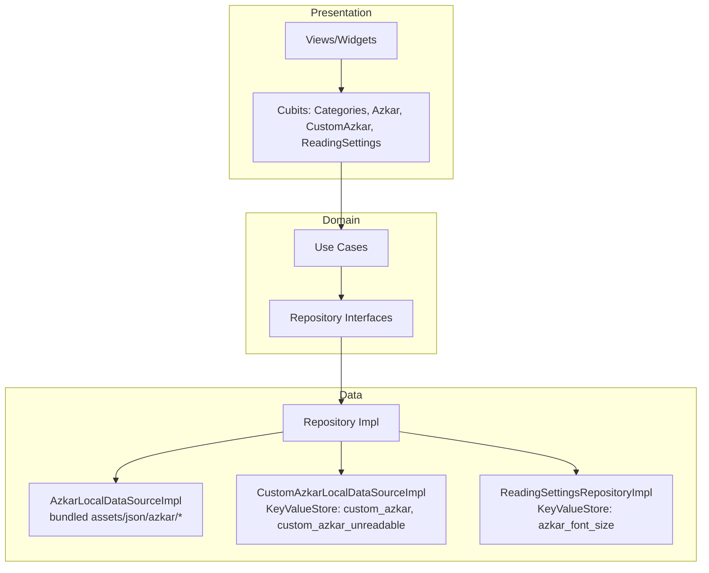
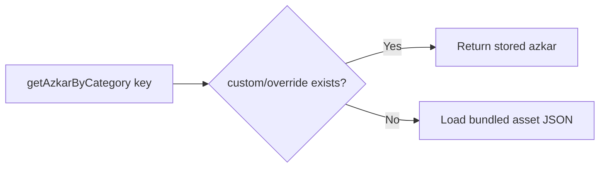

# Azkar

> **Last reviewed:** 2026-11-16  
> **Status:** In development

## Purpose & Scope
- **Goal:** Let users browse built-in azkar categories, read and count zikr in a reader, adjust reading font size, and create/manage custom categories or overrides of built-in ones.
- **Out of scope:** No cloud sync; zikr counter progress is not persisted across sessions (in-memory per reader session).

## Sources of Truth
- `lib/features/azkar/presentation/cubits/azkar/azkar_cubit.dart`
- `lib/features/azkar/presentation/cubits/categories/azkar_categories_cubit.dart`
- `lib/features/azkar/presentation/cubits/custom_azkar/custom_azkar_cubit.dart`
- `lib/features/azkar/presentation/cubits/reading_settings/reading_settings_cubit.dart`
- `lib/core/services/clipboard/clipboard_service.dart`
- `lib/features/azkar/data/repositories/azkar_repository_impl.dart`
- `lib/features/azkar/data/data_sources/custom_azkar_local_data_source_impl.dart`
- `lib/features/azkar/data/data_sources/versioned_list_store.dart`
- `lib/features/azkar/presentation/widgets/common/counter_ring.dart`

## Glossary
| Term | Meaning |
|---|---|
| Category (تصنيف/قسم) | An azkar collection. `AzkarCategoryEntity` (`key`, `title`, `cardTitle`, `isCustom`, `isModified`). |
| Zikr (ذكر) | A single item with target `count`. `ZikrEntity` (`id`, `text`, `count`, `description?`, `isUserAdded`). `canBeDeleted => isUserAdded \|\| id > 100000`. |
| Custom category | User-created category stored with id prefixed `custom_` (`customCategoryIdPrefix`). |
| Override | Modified built-in category saved under the original built-in key (no `custom_` prefix) in custom storage; shown as `isModified`. |
| Restore | Delete the stored override/custom record so reading falls back to bundled original. |

## Architecture & Flow

`AzkarRepositoryImpl.getAzkarByCategory` resolves content by preferring a stored custom/override record for the key; otherwise it loads bundled asset JSON.

## State & UI (only if non-obvious)
- **Categories:** `AzkarCategoriesCubit` merges built-in + custom records, marks built-ins `isModified` when an override exists for the same key, and lists custom (`custom_`) first.
- **Reader:** `AzkarCubit` keeps per-zikr `counters` in memory and resolves `isCustom/isModified/resolvedTitle`. `incrementZikr` returns `ZikrIncremented|Completed|Ignored`; `applyCategoryUpdate` clamps counters to new targets to preserve session progress; `resetCategory` deletes the override and reloads the original.
- **Reader completion/exit** (`presentation/views/zikr_list_view.dart`): auto-close triggers only when the session becomes fully completed with the same azkar list instance (not when edits make it complete). Auto-scroll targets the first incomplete item. Exit asks confirmation if progress started and not all completed.
- **Reader copy:** Each zikr card has a copy button that copies the resolved category title, zikr text, and its description when present, with each section wrapped in `« … »`. Clipboard access is handled by the shared core service.
- **Custom management:** `CustomAzkarCubit` emits operation states then reloads and normalizes built-in category names to app-owned originals when listing.
- **Reading settings:** `ReadingSettingsCubit` applies font-size changes immediately; on save failure it emits `Error` carrying persisted settings so the UI can revert and toast. (`widgets/reading_settings/font_size_section.dart`)
- **Tasbeeh:** `TasbeehCubit` keeps selection and independent counts for saved items. The empty home card offers three preset azkar and a matching custom-item tile; with saved items it shows the most recently used item with Continue and All actions. The counter screen uses previous/next controls; its app-bar list opens the item-management sheet.
- **Counters:** one widget, `CounterRing`, drives both the zikr and tasbeeh counters. A non-null target shows the remaining count (`target - current`) and completes on reaching it; a null target counts up freely and never completes.
- **Routes:** reader `/azkar/:categoryKey`, custom form `/custom-zikr-form`, manage list `/custom-azkar-list`, plus azkar tab in shell (`lib/core/router/app_routes.dart`, `lib/core/router/features/azkar_tasbeeh_router.dart`). Screens reload on return where needed to stay in sync with storage.

## Data & Storage
- **Bundled source:** `assets/json/azkar/categories.json` and `assets/json/azkar/<key>.json` via `AzkarLocalDataSourceImpl`.
- **Custom/overrides store** (`AppStorageKeys.customAzkar`, `CustomAzkarLocalDataSourceImpl`): versioned JSON envelope `{ "version": 1, "items": [...] }`; reads accept legacy list or missing version; uses in-memory cache and a serialized write queue; skips corrupted items (with logging) and best-effort backs up unreadable raw payload to `custom_azkar_unreadable` (not overwritten if present). The envelope, cache, write queue and backup logic live once in `VersionedListStore<T>` (`data_sources/versioned_list_store.dart`); each data source supplies keys and JSON mapping.
- **Reading settings:** `AppStorageKeys.azkarFontSize` (`double`, default 20, clamped 14–32) in `reading_settings_repository_impl.dart` / `reading_settings_entity.dart`.
- **Tasbeeh items:** `AppStorageKeys.tasbeehItems` stores each item's text, count, optional target, and last-used time in the same `VersionedListStore` envelope (`TasbeehLocalDataSourceImpl`).
- **IDs/rules:** custom category ids prefixed `custom_`; zikr `is_user_added` may be inferred from `id > 100000` on read; deletable when `isUserAdded || id > 100000`. (`azkar_constants.dart`, `zikr_model.dart`, `zikr_entity.dart`)

## Edge Cases & Limitations
- **Corrupt/unexpected custom storage:** falls back to an empty usable state while preserving unreadable raw backup; partially corrupt items are skipped to avoid silent data loss on later writes. (`custom_azkar_local_data_source_impl.dart`)
- **Concurrent writes:** serialized via a write queue to prevent lost updates.
- **Duplicate/late actions:** submit/exit/dialog guards, `PopScope(canPop: false)` in reader, and `isClosed` checks after async work to avoid duplicate handling or emits after dispose.
- **Load/save/delete failures:** mapped to `CacheFailure` with user-facing messages (`AppStrings.azkarLoadError/azkarSaveError/azkarDeleteError`); UI shows error/toast and allows retry; a failed save keeps the form open.
- **Built-in edit constraints:** built-in name locked and non-deletable original items limited to target-count edits; user-added/deletable items are editable/removable. (`custom_zikr_form_view.dart`)
- **Deep link without title extra:** title resolved from built-in categories or the stored custom record as fallback. (`azkar_cubit.dart`)
- **Limitation:** counter progress is session-only (not persisted).

## Decisions

### D-001: Prefer stored override/custom over bundled azkar per key
- **Decision:** Return azkar from the stored record for the same `categoryKey` when present; otherwise load bundled asset JSON.
- **Reason:** Enables editing built-in categories or adding custom ones without modifying assets, while making restore a simple delete. [Inferred]
- **Rejected alternatives:** Modifying asset files or performing complex runtime merges (more complexity and less safety). [Inferred]
- **Date:** 2026-11-15
- **Status:** Unconfirmed

### D-002: Distinguish custom vs built-in override by key/prefix
- **Decision:** User-created categories use ids prefixed with `custom_`, while built-in overrides are stored under the original built-in key.
- **Reason:** One storage mechanism supports both cases with clear behavior differences (`isCustom`, restore, and display ordering). [Inferred]
- **Rejected alternatives:** Separate storage/models per type (duplication and sync complexity). [Inferred]
- **Date:** 2026-11-15
- **Status:** Unconfirmed

### D-003: Keep built-in category names app-owned
- **Decision:** Keep built-in category titles as defined by the app even when an override exists, and normalize names in listing/management.
- **Reason:** Preserves the official identity of built-in categories while allowing content customization. [Inferred]
- **Rejected alternatives:** Allowing user data to rename built-in categories. [Inferred]
- **Date:** 2026-11-15
- **Status:** Unconfirmed

### D-004: Versioned resilient custom storage (cache + serialized writes + backup)
- **Decision:** Store a versioned envelope (`version/items`) that accepts legacy formats, with in-memory cache, a write queue, and skip/backup handling for corrupted data.
- **Reason:** Provides backward compatibility, better data safety, and fewer lost updates from concurrent writes. [Inferred]
- **Rejected alternatives:** Unversioned raw writes or hard-failing on first corruption (less resilient, higher data-loss risk). [Inferred]
- **Date:** 2026-11-15
- **Status:** Unconfirmed

### D-005: Session-only counter progress with clamped apply-on-edit
- **Decision:** Keep reading counters in memory only, and when applying edits preserve progress by clamping counters to new targets.
- **Reason:** Simplifies persistence while avoiding loss of current-session progress during edits. [Inferred]
- **Rejected alternatives:** Persisting detailed per-zikr progress permanently (added complexity and sync/state cases). [Inferred]
- **Date:** 2026-11-15
- **Status:** Unconfirmed

### D-006: One shared implementation per UI pattern, thin public wrappers
- **Decision:** Keep `CounterRing`, `AppFormSheet`, `AppStateView`, `AppButton` and `VersionedListStore<T>` as the single implementations. Public names (`ZikrCounter`, `TasbeehCounter`, `AddZikrBottomSheet`, `TasbeehItemFormBottomSheet`, `AppEmptyView`, `AppErrorView`, `AppPrimaryButton`, `AppSecondaryButton`) stay as wrappers so call sites keep their intent.
- **Reason:** Removes duplicated logic without touching call sites, which keeps tests and screen code stable.
- **Rejected alternatives:** Rewriting every call site to the new names (wider diff, no behavioural gain).
- **Date:** 2026-11-16
- **Status:** Confirmed