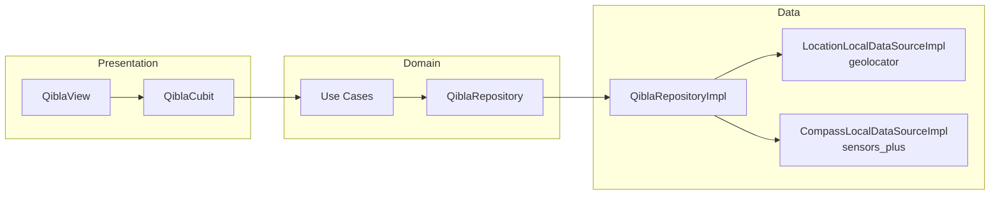

# Qibla

> **Last reviewed:** 2026-11-23
> **Status:** In development

## Purpose & Scope

- **Goal:** Let users find the direction of the Qibla from their exact current location with a compass, fully offline and without an account, and know clearly when they are facing it.
- **Out of scope:** Camera view with Qibla arrow (AR), map with line to Kaaba, home-screen widget, vibration or sound when facing, saved/manual location, settings screen for Qibla, offline notice or banner, help/instructions screen (removed by developer).

## Sources of Truth

- `lib/features/qibla/domain/repositories/qibla_repository.dart`
- `lib/features/qibla/data/repositories/qibla_repository_impl.dart`
- `lib/features/qibla/presentation/cubits/qibla/qibla_cubit.dart`
- `lib/features/qibla/presentation/views/qibla_view.dart`
- `lib/core/router/app_router.dart`

## Glossary

| Term | Meaning |
|------|---------|
| Qibla direction | Direction from user's location to the Kaaba, measured in degrees from true north (0-360). |
| True north | Geographic north pole direction, calculated from GPS coordinates. |
| Facing tolerance | 6 degrees — within this range, the app shows the `AppStrings.qiblaFacing` confirmation message. |
| Kaaba coordinates | 21.4225, 39.8262 (Makkah, Saudi Arabia). |

## Architecture & Flow

## State & UI

- **States:** sealed `QiblaState` variants: `QiblaInitial` → `QiblaPermission` → `QiblaLoading` → `QiblaCompass` / `QiblaDenied` / `QiblaFailed` / `QiblaUnsupported`. The view switches on the state type.
- **Skeleton loading:** The loading state shows the compass screen layout through `Skeletonizer` (no separate loading screen).
- **Message card:** Single card at the top shows current action (turn left/right, remaining degrees, facing confirmation, low accuracy, level guidance). Both the title and the message are unbounded, so the card height is driven entirely by the text and the guidance is never clipped. Its text color carries the tone: gold for success, red for warning/error, neutral for ordinary guidance.
- **Compass dial:** Circular dial rotates with phone direction. Kaaba icon on rim, line to center. No cardinal direction labels.
- **Facing confirmation:** Within the facing tolerance (see Glossary), compass details turn yellow and the message card shows the `AppStrings.qiblaFacing` confirmation.
- **Visual style:** Night mode uses a black background with white compass details; no glow or bloom is used. The message card keeps a consistent surface across states — only its text content and its tone color change to reflect the current state.

## Data & Storage

- **No location persistence:** Location is fetched from GPS every time the screen opens.
- **Kaaba coordinates:** Hardcoded (21.4225, 39.8262).

## Edge Cases & Limitations

- **No compass sensor:** On entering the screen the check reports no compass sensor, so the Qibla screen immediately shows the `unsupported` state explaining the device does not support the compass sensor (`lib/features/qibla/domain/use_cases/check_compass_sensor_use_case.dart`). The Settings shortcut does not pre-check support — see Tech Debt.
- **Permission denied:** Screen shows a button to open app settings plus numbered steps (open settings → permissions → location → allow → return); tracking resumes automatically when I return (`lib/features/qibla/domain/use_cases/open_app_settings_use_case.dart`).
- **Location failure (permission granted but no fix):** Screen shows two numbered steps (enable Location from the notification shade and return, or open location settings, enable it, and return) plus a button to open location settings; the direction is recalculated automatically on return (`lib/features/qibla/domain/use_cases/open_location_settings_use_case.dart`).
- **Low compass accuracy:** Message card shows the low-accuracy title with the shared flat-surface/metals guidance (`AppStrings.qiblaFlatSurfaceGuidance`); no calibration button or bottom sheet (`lib/features/qibla/presentation/widgets/message_card.dart`). The tone color is red (warning treated as error).
- **Phone not level:** Message card shows the same shared `AppStrings.qiblaFlatSurfaceGuidance` text with a "place the phone flat" title (`lib/features/qibla/presentation/widgets/message_card.dart`). Tone color is red.
- **Offline:** Feature works fully offline; no offline notice or banner shown.
- **Returning from settings:** Permission is rechecked when the app resumes; if granted, tracking restarts automatically without an extra tap (`lib/features/qibla/presentation/cubits/qibla/qibla_cubit.dart`).

## Decisions

### D-001: Great Circle Bearing for Qibla calculation
- **Decision:** Use Great Circle Bearing formula from user's GPS location to Kaaba coordinates.
- **Reason:** Standard formula for Qibla direction, works offline without external APIs. [Inferred]
- **Rejected alternatives:** Rhumb line (less accurate for long distances), external API (conflicts with offline priority).
- **Date:** unknown
- **Status:** Unconfirmed

### D-002: North True (True North) for direction
- **Decision:** Calculate direction from true north, not magnetic north.
- **Reason:** GPS coordinates inherently use true north; no need for magnetic declination correction. [Inferred]
- **Rejected alternatives:** Magnetic north (requires declination data, adds complexity).
- **Date:** unknown
- **Status:** Unconfirmed

### D-003: Single screen with multiple states
- **Decision:** One QiblaView handles all states (permission, loading, compass, denied, failed, unsupported) instead of separate screens.
- **Reason:** Simpler navigation, matches the emulator design, reduces route complexity. [Inferred]
- **Rejected alternatives:** Separate route per state (more routes, more complexity).
- **Date:** unknown
- **Status:** Unconfirmed

### D-004: No bottom nav tab for Qibla
- **Decision:** Qibla is a standalone route (`/qibla`) pushed from the Settings screen, not a tab in the bottom navigation bar.
- **Reason:** Qibla is accessed temporarily from Settings, not a main app section. Pushing it keeps the previous screen underneath so back returns there. [Inferred]
- **Rejected alternatives:** Bottom nav tab (would make Qibla a primary section), `go` navigation (would drop the stack and send back to Home).
- **Date:** unknown
- **Status:** Unconfirmed

### D-005: Kaaba icon via the AppIcons token
- **Decision:** Use the `AppIcons.kaaba` token (which maps to `FlutterIslamicIcons.solidKaaba` in `lib/core/theme/icons/app_icons.dart`).
- **Reason:** No new asset file needed; consistent with the existing icon tokens. [Inferred]
- **Rejected alternatives:** Custom SVG asset (requires adding an asset to pubspec.yaml).
- **Date:** unknown
- **Status:** Unconfirmed

### D-006: Skeleton renders the real success widget
- **Decision:** `QiblaLoadingSkeleton` puts the real `QiblaCompassContent` with a dummy state inside `Skeletonizer`, matching the azkar skeletons.
- **Reason:** Pixel-perfect match with the loaded screen; the skeleton follows any UI change automatically. [Inferred]
- **Rejected alternatives:** Hand-built placeholder widgets that can drift from the real layout.
- **Date:** 2026-11-23
- **Status:** Unconfirmed

### D-007: Message tone colors — warning counts as error
- **Decision:** Guidance tone drives the message color: success = brand gold, low accuracy / not flat = error red (warnings treated as errors), normal = neutral.
- **Reason:** Developer decision on 2026-11-23 to distinguish error from success at a glance. [Confirmed]
- **Rejected alternatives:** Single neutral color for every guidance state.
- **Date:** 2026-11-23
- **Status:** Active

### D-008: One shared flat-surface/metals guidance message
- **Decision:** Low accuracy and not-flat states use the same `AppStrings.qiblaFlatSurfaceGuidance` text; only the title differs.
- **Reason:** Developer decision on 2026-11-23 — the single sentence is clearer than two near-duplicate wordings. [Confirmed]
- **Rejected alternatives:** Two separate description strings with slightly different wording.
- **Date:** 2026-11-23
- **Status:** Active

### D-009: Text-driven message-card height
- **Decision:** The card has no fixed height; content is unbounded and padding is `AppSize.p20`.
- **Reason:** Developer decision on 2026-11-23 — the text controls the card so guidance is never clipped, with slightly larger base padding than before. [Confirmed]
- **Rejected alternatives:** A fixed `minHeight` (tried and reverted), or `maxLines` + ellipsis.
- **Date:** 2026-11-23
- **Status:** Active

### D-010: Qibla route declared inline in app_router
- **Decision:** A single `GoRoute` for Qibla lives in `app_router.dart`; no `qibla_router.dart` file.
- **Reason:** Developer decision on 2026-11-23 — one screen does not justify a separate router file. [Confirmed]
- **Rejected alternatives:** A `core/router/features/qibla_router.dart` exposing `qiblaRoutes` (deleted).
- **Date:** 2026-11-23
- **Status:** Active

### D-011: Integration tests inject a fake repository via GetIt
- **Decision:** `integration_test/qibla_harness.dart` registers a controllable `QiblaRepository` fake through `sl`; the real router, view and cubit still run on the device.
- **Reason:** The real device cannot programmatically grant location permission or produce a GPS fix for every scenario; injection keeps every branch deterministic. [Inferred]
- **Rejected alternatives:** Mocking the platform channels, or driving only the real happy path.
- **Date:** 2026-11-23
- **Status:** Unconfirmed

## Tech Debt / Incomplete

- Compass heading uses a circular low-pass filter over the magnetometer reading (`AppConstants.qiblaHeadingSmoothing025`); its tuning may still need real-device validation.
- Facing tolerance (see Glossary) was set by developer decision and may still need adjustment based on real device testing.
- Turning location service off while the compass is open keeps the last calculated bearing until the screen is reopened (accepted; the compass is normally opened fresh).
- The Settings shortcut should check compass-sensor support the same way the `unsupported` state does — enable the card when the device has a sensor, disable it otherwise. Not applied yet because the Settings shortcut is a temporary entry.

## Verification
- Unit/widget coverage: all Qibla feature files covered; full suite 832 tests passing.
- Integration flows: 10 tests passing on a real Android device (`SM A226B`) on 2026-11-23.
- `flutter analyze`: no issues.

## Screenshots

TBD — screenshots to be captured under `screenshots/qibla/` and referenced here (requirement restored 2026-11-23).

