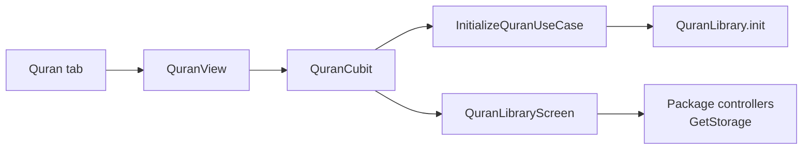

# Quran

> **Last reviewed:** 2026-11-28
> **Status:** In development

## Purpose & Scope

- **Goal:** Let the user open the Quran without friction and continue from where they stopped, with simple tools for listening, memorization, and completing a Khatma.
- **Out of scope:** Separate top-bar icons for index/search/bookmarks, a custom app bar replacing the package top bar, changes to the Tajweed icon, and an app-owned microphone permission flow (all deferred or rejected by the developer on 2026-11-28).

## Sources of Truth

- `lib/features/quran/presentation/views/quran_view.dart`
- `lib/features/quran/presentation/cubits/quran/quran_cubit.dart`
- `lib/features/quran/domain/use_cases/initialize_quran_use_case.dart`
- `lib/core/di/features/quran_di.dart`
- `android/app/src/main/kotlin/com/sana/muslim/app/MainActivity.kt`
- `android/app/build.gradle.kts`

## Glossary

| Term | Meaning |
|------|---------|
| Mushaf | The paginated Quran view rendered by `quran_library`. |
| Ayah | A verse of the Quran. |
| Tafsir | Exegesis shown for an ayah; opened from the package's ayah action strip. |
| Tajweed | Recitation rules; the package can color the text, controlled from the fonts dialog. |
| Tasmee | AI recitation checking; uses the microphone. |
| Fawasil | Bookmarks in the package (`BookmarksCtrl`). |
| Display mode bar | The side switch that changes between Mushaf and Tafsir display modes. |

## Architecture & Flow

## State & UI

- **States:** sealed `QuranState` variants `QuranInitial` → `QuranLoading` → `QuranReady` / `QuranFailed`. The view switches on the state type.
- **Loading:** a centered `CircularProgressIndicator` using `context.color.primary`; it replaced an earlier skeleton after the developer asked for a simple spinner.
- **Failure:** `AppErrorView` with a retry action; the retry emits `QuranInitial` and calls `initialize()` again.
- **Lifecycle:** `initialize()` returns early when the cubit is closed or the state is not `QuranInitial`; after every `await` it checks `isClosed` before emitting.
- **Screen configuration:** the package screen is used directly. It receives `isShowTabBar: false`, `isShowDisplayModeBar: false`, `isShowAudioSlider: false`, `topBarStyle.copyWith(showAudioButton: false)`, and `ayahMenuStyle.copyWith(showPlayAllButton: false)`. The package list button and the Tajweed "!" icon remain visible.

## Data & Storage

- The package owns the Mushaf data and persistence (last page, fonts, bookmarks, Tasmee settings) through `GetStorage`; the feature does not add its own storage layer.
- `QuranLibrary.init()` is called once per app session; the package has an internal guard against double initialization.

## Edge Cases & Limitations

- **Firebase Performance crash:** the app applied the `com.google.firebase.firebase-perf` Gradle plugin while the `firebase_performance` Flutter dependency had been removed earlier (commit `f3a4c70c`). ExoPlayer from `just_audio` then hit `NoClassDefFoundError: com.google.firebase.perf.network.FirebasePerfUrlConnection` on the first HTTP stream and the process was killed. The plugin declaration was removed from both Gradle files; `firebase_core` and Crashlytics are unchanged.
- **Audio service activity:** `audio_service` requires `MainActivity` to extend `AudioServiceActivity` for system media controls. The file previously had the import commented out with a note that the Quran feature was removed; it was restored on 2026-11-28. Without it, playback still works locally but `AudioService.init()` fails and a warning is logged.
- **Material 3:** the package documentation asks for `useMaterial3: false`; the app theme currently uses `useMaterial3: true`. Possible layout differences are unverified. [Inferred]
- **Microphone permission:** when a user denies microphone access, the package writes its raw error string into the Tasmee control bar. The app does not own this flow yet (deferred).
- **Fonts:** the package downloads Mushaf fonts on demand and caches them; offline behavior after download has not been verified by the developer.
- **Dead style flag:** `QuranTopBarStyle.showTajweedButton` exists in `quran_library` 5.0.1 but is not read by any widget; the Tajweed icon is gated by `showMenuButton` and `fontsSelected == 0`.
- **Custom top-bar widgets:** `customTopBarWidgets` are placed between two spacers in the package top bar, so extra controls appear centered rather than beside the list button. This is why the earlier search/bookmark buttons were removed.

## Decisions

### D-001: Use quran_library as the Mushaf engine
- **Decision:** Build the feature on `quran_library: ^5.0.1` and use it fully instead of implementing a custom Mushaf renderer.
- **Reason:** Explicit developer instruction on 2026-11-28. [Confirmed]
- **Rejected alternatives:** Custom page renderer built on the app's own fonts and data.
- **Date:** 2026-11-28
- **Status:** Active

### D-002: Initialize the package when the feature opens
- **Decision:** Call `QuranLibrary.init()` from a use case triggered by `QuranCubit` when the Quran tab opens, instead of during app startup.
- **Reason:** The developer described a feature-level preparation loading state before the Mushaf appears. [Inferred]
- **Rejected alternatives:** App-wide initialization in `main.dart` before `runApp`, which would show no in-feature loading state.
- **Date:** 2026-11-28
- **Status:** Unconfirmed

### D-003: Configure the package through public flags and styles
- **Decision:** Hide unwanted built-in controls with `QuranLibraryScreen` flags and style `copyWith(...)`, without forking or patching the package.
- **Reason:** Keeps the feature on official package updates and follows the project rule that `lib/` remains the source of truth. [Inferred]
- **Rejected alternatives:** Forking the package; building a full custom app bar (explicitly declined by the developer).
- **Date:** 2026-11-28
- **Status:** Unconfirmed

### D-004: Remove the Firebase Performance Gradle plugin
- **Decision:** Remove `com.google.firebase.firebase-perf` from `settings.gradle.kts` and `app/build.gradle.kts` instead of re-adding the `firebase_performance` Flutter dependency.
- **Reason:** The app does not use Firebase Performance, and the plugin's bytecode instrumentation crashed ExoPlayer when the runtime class was absent. [Inferred]
- **Rejected alternatives:** Re-adding `firebase_performance` and its native SDK, which would restore instrumentation and add dependency weight.
- **Date:** 2026-11-28
- **Status:** Unconfirmed

### D-005: Keep the package list button and Tajweed icon
- **Decision:** Leave the package's list button as the single index/search/bookmarks entry point and keep the Tajweed "!" icon visible.
- **Reason:** Developer decision on 2026-11-28 after trying separate top-bar icons. [Confirmed]
- **Rejected alternatives:** Three separate top-bar icons; hiding the Tajweed icon immediately.
- **Date:** 2026-11-28
- **Status:** Active

## Tech Debt / Incomplete

- `spec.md` has no developer-confirmed Goal wording, and no requirement has been verified in the running app after the latest UI changes.
- No screenshots captured yet for the Mushaf screen, loading state, error state, or ayah action strip.
- Landing / onboarding page before the Mushaf is planned but not started.
- Themed surah-number circle color is requested but not applied.
- App-owned microphone permission handling is deferred.
- The Tajweed icon remains visible; its removal is deferred.
- No unit, widget, or integration tests have been added for this feature yet.
